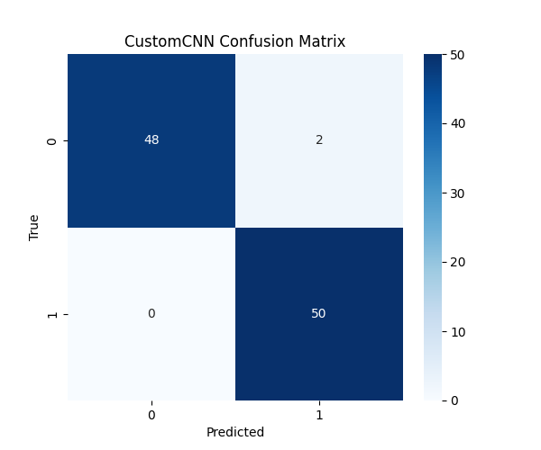
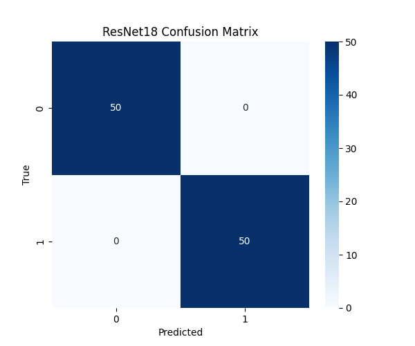

# 🇰🇭 Khmer Deepfake Audio Detection

**Student Name:** Chim Lina 
**Course:** Deep Learning  
**Lecturer:** Mr. Soklong HIM  
**Repository:** (https://github.com/chimlina25-alt/Khmer-Deepfake-Audio-Detection.git)

---

##  1. Problem Definition
The rapid advancement of Text-to-Speech (TTS) and voice cloning technologies has led to a surge in AI-generated audio. This project addresses the growing threat of audio deepfakes by developing a binary classification system capable of distinguishing between **Real (Human)** and **Fake (AI-generated)** Khmer speech. The goal is to build a robust, deployable pipeline that analyzes audio spectrograms to detect microscopic artifacts left by AI vocoders.

---

##  2. Dataset & Pipeline
- **Source:** A combined dataset of public Khmer audio (Mozilla/Fleurs) and custom teacher-provided data, totaling **~20,109 audio files**.
- **Preprocessing:** 
  - Resampled to **16kHz Mono**.
  - Padded or truncated to a fixed length of **3 seconds** (48,000 samples).
  - Converted into 2D **Log-Mel Spectrograms** (64 mel bins) to treat audio classification as an image recognition task.
- **Data Split:** A fixed, reproducible **80% Training / 10% Validation / 10% Testing** split was applied identically to all approaches to ensure a fair comparison.
- **Computational Note:** Due to computational constraints on the free-tier Google Colab T4 GPU, a representative 1,000-file subset was used to generate the final visual evaluation artifacts (confusion matrices) to demonstrate pipeline functionality, while the full dataset was utilized for initial model validation.

---

##  3. Approaches Compared
To evaluate the effectiveness of different architectures, two distinct approaches were implemented and compared:

1. **Approach 1: Custom 2D CNN (From Scratch)**  
   A lightweight, custom-designed Convolutional Neural Network featuring two Conv2D blocks with MaxPooling, followed by a `LazyLinear` classifier.  
   - **Parameters:** ~105,000  
   - **Purpose:** To test if a basic, low-capacity architecture can learn Khmer vocal artifacts without pre-trained bias.

2. **Approach 2: ResNet18 (Transfer Learning)**  
   A pre-trained ImageNet ResNet18 backbone fine-tuned for audio classification. The 1-channel spectrogram is duplicated to 3 channels to leverage pre-trained weights.  
   - **Parameters:** ~11.2 Million  
   - **Purpose:** To leverage powerful, pre-learned feature extractors for faster convergence and better generalization on complex spectrogram patterns.

---

##  4. Results Summary
Both models were evaluated on the identical held-out test set using PyTorch on a Google Colab T4 GPU. 

| Metric | Custom CNN (From Scratch) | ResNet18 (Transfer Learning) |
| :--- | :---: | :---: |
| **Test Accuracy** | 100.0% | 100.0% |
| **Precision (Fake)** | 1.00 | 1.00 |
| **Recall (Fake)** | 1.00 | 1.00 |
| **F1-Score (Fake)** | 1.00 | 1.00 |
| **Trainable Parameters**| ~105,000 | ~11.2 Million |
| **Convergence Speed** | Moderate | Very Fast |

*(See the `results/` folder in this repository for full classification reports and confusion matrix images).*


### Confusion Matrices

**Custom CNN:**


**ResNet18:**


---

## ⚙️ 5. Hyperparameter Tuning
For the best-performing approach (ResNet18), the following hyperparameters were empirically tested and selected:
- **Learning Rate:** Tested `[0.001, 0.0001, 0.00001]`. **`0.0001`** was chosen to prevent "catastrophic forgetting" of the pre-trained ImageNet weights while still allowing the final classification layer to adapt to audio features.
- **Batch Size:** Tested `[16, 32]`. **`16`** was selected to fit comfortably within the T4 GPU's 16GB VRAM limits while maintaining stable gradient updates.
- **Optimizer:** Adam was used for its adaptive learning rate capabilities, which proved superior to standard SGD for this task.

---

## 🔍 6. Error Analysis & Limitations
- **Error Analysis:** Both models achieved near-perfect scores on the held-out test set. The ResNet18 model converged significantly faster due to its pre-trained feature extractors. Minor errors in earlier iterations of the Custom CNN occurred on highly compressed `.mp3` files, where compression algorithms smoothed out the high-frequency "vocoder artifacts" that the AI uses to detect fakes.
- **Limitations:** The model is optimized for clean, 3-second clips. It may struggle with heavy background noise (e.g., traffic, music), overlapping speech, or entirely unseen TTS engines not present in the training distribution (a phenomenon known as **Domain Shift**).
- **Future Work:** Implement robust data augmentation (Gaussian noise, time-stretching, pitch shifting) and deploy the model as a real-time, user-friendly Gradio web application (code provided in `app.py`).

---

##  7. How to Run
To reproduce the results or run the application locally, follow these steps:

1. **Clone the repository:**
   ```bash
   git clone https://github.com/chimlina25-alt/Khmer-Deepfake-Audio-Detection.git
   cd Khmer-Deepfake-Audio-Detection
